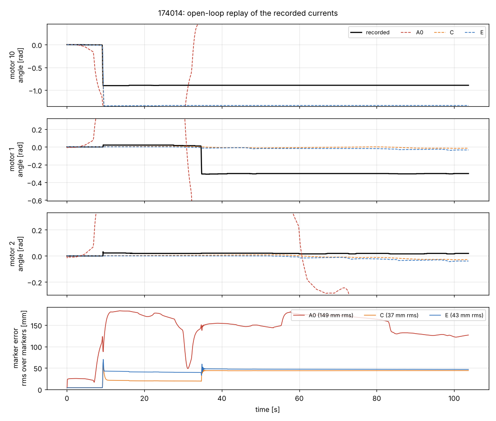
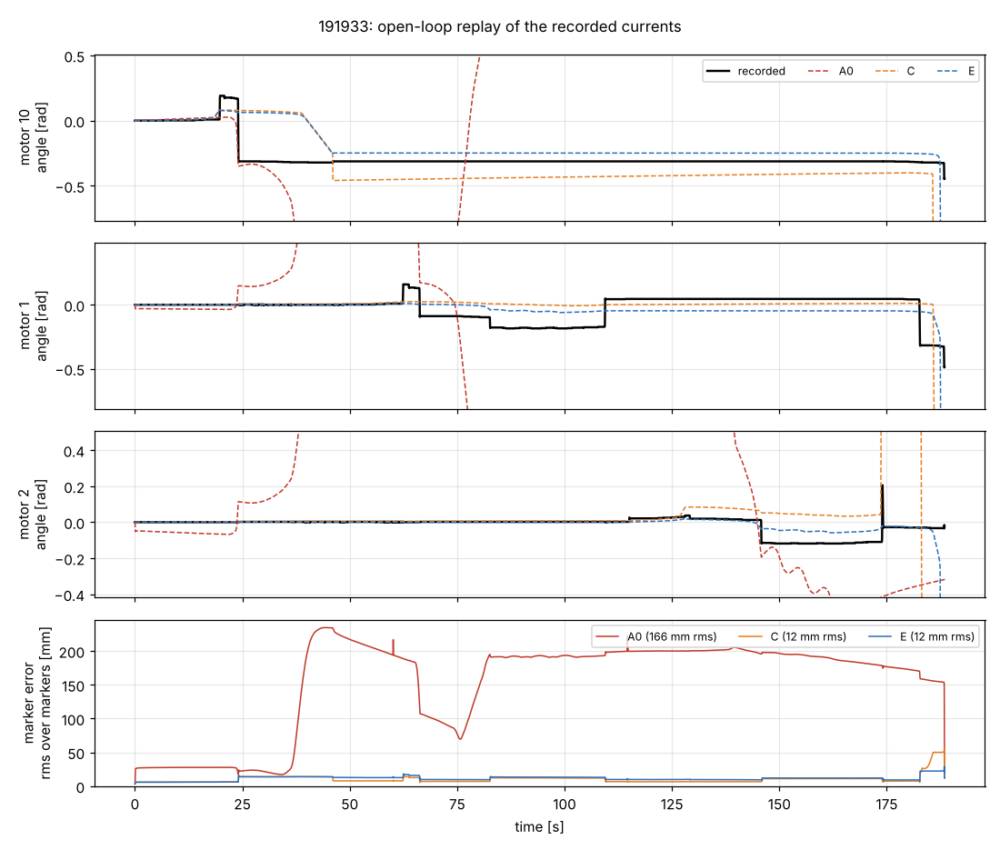
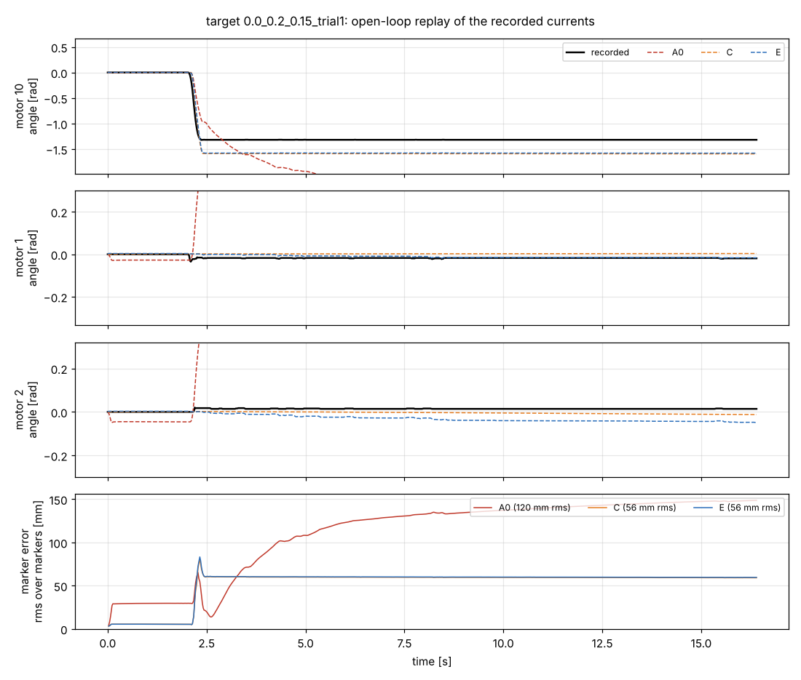
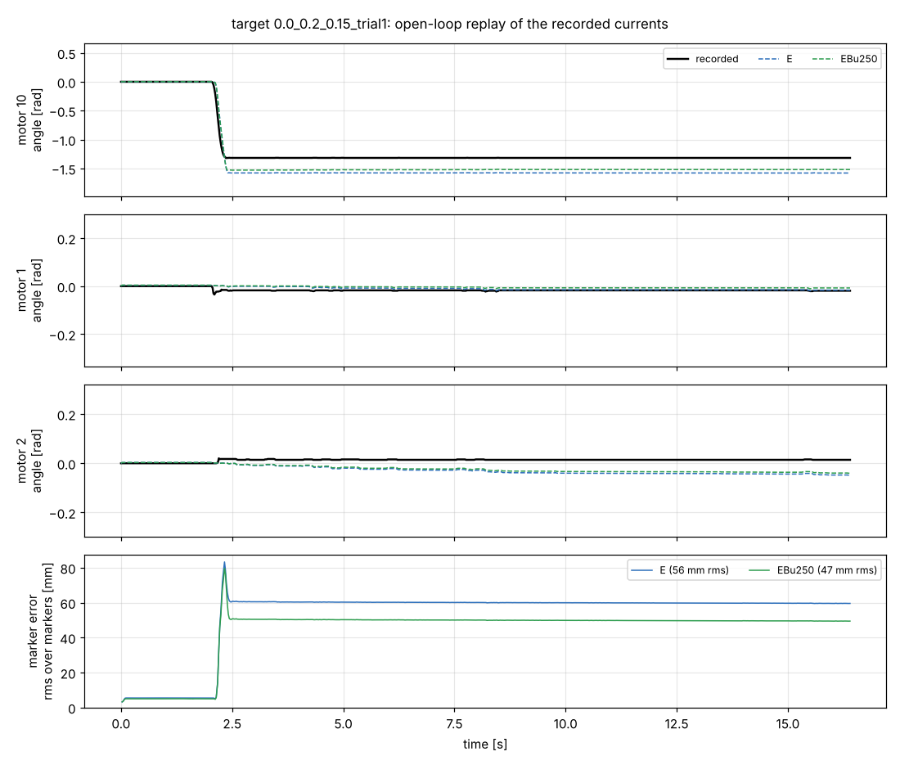

# Drive model for the SpiRob MuJoCo model

Which model of the drives (AK motor in current mode + tendon) makes the MuJoCo SpiRob reproduce the
robot when driven open loop by the recorded motor currents. Data: the 2026-11-03 hardware runs
(`drive_model_bundle_20261103`, not in the repo). Scripts: `tools/drive_model_study/`.

## Summary

- **Winner: option E**, the drives as their own degrees of freedom with MuJoCo's `dcmotor` (current mode
  through its on-board controller, 24 V bus limit) and LuGre stick-slip, on a common *compression
  carriage* that stands for the robot's axial give, with pull-only tendons and hinge friction that holds a
  pose. It is plain MJCF and lives in the robot XML (`spirob_mujoco` `models/spirob.xml`); `tendon_clf`
  uses it as `drive_model='motor'` for the simulated plants and `replay_hw`; the estimator and the
  controller keep the current-source model ([Estimation and control](#estimation-and-control)).
  **Off by default** in `tendon_clf`, see [Default](#default).
- Open-loop marker error, mean of the two fit runs: **157.6 mm today (A) -> 27.5 mm (E)**; validation
  (five closed-loop runs, not refitted): **131.1 mm -> 52.9 mm**. E is better than today's model in every
  phase of every run.
- Most of the gain over today's model comes from the robot holding its pose (hinge friction with a stiff
  friction constraint): with it, every option that never slips (A, B, D) lands at 40-41 mm on the fit
  runs; a model that does not move at all gets 40.8 mm. What E adds is the slips: the big wind-in slips
  (the ones that move the robot) start at the right current, within 0.015 A.
- Not solved: E reproduces 3 of the 13 recorded fast slips (each within 0.03 A of the recorded onset),
  slips about 50 % too far, and misses most small slips of the drive tests. Breakaway in open loop is a
  knife edge in (static friction - tension), and the tensions drift with every slip.
- The remaining error after a correct slip is in the robot's shape for a given winding (tens of mm at
  the tip in the validation runs), i.e. the robot model, not the drive.

## What the data says

All from motor_state and the markers of `20261103_174014` (staircase) and `20261103_191933` (drive tests).

1. **The robot is a ratchet.** Between slips nothing moves: currents from -0.1 to -0.4 A on stuck drives
   leave the markers within a millimetre. Everything happens in a few fast slips (0.1-0.3 s).
2. **Breakaway arithmetic.** With the static friction of a drive `Fs` and the tension `T` in its tendon,
   a stuck drive winds in at `G|i| = Fs + T` and pays out at `G i = Fs - T` (G = 31.75 N/A). Fast-slip
   onsets from motor_state (not the node's creep-based events):

   | | recorded | |
   |---|---|---|
   | slack wind-in (T = 0) | -0.283, -0.299, -0.324 A | Fs = 9.0-10.3 N |
   | taut wind-in | -0.374, -0.387, -0.392, -0.400 A | |
   | pay-out | +0.165, +0.186, +0.222, +0.254 A | |

   Pairing taut wind-in and pay-out per motor: Fs = [10.0, 9.2, 9.7] N and T = [1.9, 3.4, 2.7] N for
   motors 10, 1, 2. The antagonist tensions stay near 2-4 N even after another tendon wound in 35 mm.
   And motor 10 could not wind in at -0.5 A right after its own slip in 191933: the slip left its tension high.
3. **The give is common-mode.** When one tendon winds in, the two antagonists' paths lengthen ~10 mm
   while their drives stay stuck, and the robot shortens ~11 mm (README of the bundle). An axial
   compression of the robot shortens all three tendon paths alike, so one tendon can bend the robot
   without loading the stuck antagonists. A spring in each tendon cannot do that: in the per-tendon
   version of E the antagonists reach ~12 N after a slip, then either slip back or block the next wind-in.
4. **The model's own sag.** At the fitted start pose the model needs tendon 10 (top) to carry the weight;
   with MuJoCo's default friction impedance the hinges creep and load it within seconds
   (25 mm of marker error in the 2 s lead phase of today's model). The robot does not creep.

## Options

All options are scored with the same replay: recorded `commanded_current` at 1 ms, from the
marker-fitted start pose, 15 markers. Shared parameters (fitted with E, then used by every option):
hinge friction `0.165 N m * (k_i / k_1)^0.55` (k = hinge stiffness) with friction solref `0.002 1` and
solimp `0.9999 0.99999`, hinge stiffness scale 0.61. The 25 mm tendon radius is unchanged.

| | drive | give | friction law | where it lives |
|---|---|---|---|---|
| A0 | today: `<motor>` current source on the robot tendon | none | Coulomb tendon frictionloss 2.5 N, soft | MJCF + voltage limit in code |
| A | as A0 + shared parameters | none | tendon frictionloss 5 N, solimp 0.999/0.9999 | MJCF + code |
| B | current source on the robot tendon, pull-only | none | frictionloss switched static 9.5 N / sliding 2 N by tendon speed, + plate hole ∝ pull | code (per-step switching) |
| C | motor slide DOF (rotor inertia), current source | compression carriage + pull-only tendon springs | Karnopp: motor frictionloss switched Fs / Fc by motor speed | code (per-step switching) |
| D | `dcmotor` + LuGre on the robot tendon | LuGre bristle (sigma0) | LuGre | MJCF |
| E | motor slide DOF + `dcmotor` + LuGre | compression carriage + pull-only tendon springs | LuGre | MJCF |

B, C and D were given a small grid over their own drive parameters on top of the shared ones
(`tools/drive_model_study/options.json` holds the best of each); E was fitted by coordinate search.
Positive current: A0, A, B and D clip it (a MuJoCo tendon could push); in C and E it pays out a slack tendon.

## Results

Marker error is the rms over markers and samples; slips are fast slips on the motor angle (|dθ/dt| over
20 ms > 0.5 rad/s, |Δθ| > 0.03 rad), matched to the recorded ones by motor, direction and time (±2 s).
Fit runs: 174014 and 191933 (13 recorded slips). Cost: bare stepping loop including the per-step drive
law in Python, one core, ms of wall time per simulated second.

| option | 174014 [mm] | 191933 [mm] | fit mean [mm] | validation mean, 5 runs [mm] | slips matched (of 13) | onset within 0.03 A | mean onset error [A] | mean size error [rad] | spurious slips | max spring-back [rad] | cost [ms / sim s] | MJCF only |
|---|---|---|---|---|---|---|---|---|---|---|---|---|
| A0 | 148.7 | 166.5 | 157.6 | 131.1 | 4 | 2 | 0.037 | 0.22 | 16 | 0.005 | 334 | yes (+ voltage limit in code) |
| A | 70.0 | 11.0 | 40.5 | 98.7 | 0 | 0 | - | - | 0 | 0.000 | 354 | yes (+ code) |
| B | 70.3 | 11.3 | 40.8 | 93.5 | 0 | 0 | - | - | 0 | 0.000 | 325 | no |
| C | 36.9 | 12.0 | 24.5 | 52.7 | 2 | 2 | 0.006 | 1.38 | 5 | 0.001 | 290 | no |
| D | 70.2 | 11.2 | 40.7 | 98.0 | 0 | 0 | - | - | 0 | 0.000 | 303 | yes |
| **E** | **43.2** | **11.8** | **27.5** | **52.9** | 3 | 3 | 0.010 | 0.94 | 1 | 0.006 | 187 | **yes** |

Recorded max spring-back on unloading: 0.007 rad (A0's matched slips are its own creeping, not the
robot's slips). A0's 16 spurious "slips" are the soft tendon friction creeping.

Validation runs (closed-loop EKF + CLF-QP runs to two targets, replayed open loop, not refitted), marker rms [mm]:

| option | (0, 0.2, 0.15) trial 1 | trial 2 | trial 3 | (-0.05, 0.2, 0.15) trial 1 | trial 2 |
|---|---|---|---|---|---|
| A0 | 119.9 | 147.0 | 147.6 | 117.1 | 123.7 |
| A | 98.2 | 88.6 | 93.1 | 102.4 | 111.2 |
| B | 94.8 | 86.0 | 90.4 | 90.9 | 105.3 |
| C | 55.8 | 49.1 | 43.2 | 56.3 | 59.0 |
| D | 98.6 | 89.2 | 92.9 | 98.7 | 110.6 |
| E | 56.2 | 50.1 | 43.7 | 56.0 | 58.7 |

Per phase, 174014 [mm]:

| phase | A0 | A | B | C | D | E |
|---|---|---|---|---|---|---|
| lead | 25 | 3 | 3 | 4 | 3 | 4 |
| stairs 0 up | 84 | 35 | 35 | 15 | 35 | 21 |
| stairs 0 down | 180 | 74 | 75 | 20 | 75 | 41 |
| ramp 0 | 174 | 73 | 74 | 20 | 74 | 40 |
| rest 0 | 169 | 73 | 74 | 20 | 74 | 40 |
| stairs 1 up | 129 | 73 | 73 | 26 | 74 | 41 |
| stairs 1 down | 152 | 73 | 73 | 44 | 73 | 48 |
| ramp 1 | 148 | 73 | 73 | 43 | 73 | 47 |
| rest 1 | 146 | 73 | 73 | 43 | 73 | 47 |
| stairs 2 up | 167 | 73 | 73 | 43 | 73 | 47 |
| stairs 2 down | 173 | 73 | 74 | 44 | 74 | 47 |
| ramp 2 | 170 | 73 | 74 | 44 | 73 | 47 |
| rest 2 | 167 | 74 | 74 | 44 | 73 | 47 |
| stairs 1+2 up | 150 | 74 | 74 | 44 | 73 | 47 |
| stairs 1+2 down | 128 | 74 | 74 | 44 | 74 | 47 |
| ramp 1+2 | 125 | 74 | 74 | 44 | 74 | 47 |
| rest 1+2 | 124 | 74 | 74 | 44 | 74 | 46 |
| done | 127 | 74 | 74 | 44 | 74 | 46 |

Per phase, 191933 [mm]:

| phase | A0 | A | B | C | D | E |
|---|---|---|---|---|---|---|
| lead | 26 | 3 | 3 | 6 | 3 | 6 |
| out 0 | 27 | 5 | 5 | 7 | 5 | 7 |
| in 0 | 146 | 12 | 12 | 13 | 12 | 14 |
| out 1 | 193 | 11 | 11 | 9 | 12 | 13 |
| in 1 | 127 | 9 | 11 | 8 | 11 | 10 |
| cycles 1 | 192 | 13 | 15 | 12 | 14 | 13 |
| reset 1 | 194 | 12 | 13 | 11 | 13 | 12 |
| out 2 | 200 | 9 | 9 | 7 | 10 | 10 |
| in 2 | 202 | 10 | 9 | 7 | 10 | 10 |
| cycles 2 | 191 | 11 | 11 | 11 | 11 | 12 |
| reset 2 | 181 | 11 | 10 | 11 | 11 | 11 |
| together | 166 | 18 | 17 | 29 | 17 | 17 |
| done | 113 | 24 | 24 | 39 | 23 | 23 |

Slips of E (onset current [A] / size [rad]):

| run | t [s] | motor | recorded | E |
|---|---|---|---|---|
| 174014 | 9.1 | 10 | -0.374 / -0.89 | -0.389 / -1.31 |
| 174014 | 34.6 | 1 | -0.400 / -0.31 | none |
| 191933 | 19.7 | 10 | +0.254 / +0.18 | none |
| 191933 | 24.0 | 10 | -0.324 / -0.48 | none |
| 191933 | 62.3 | 1 | +0.186 / +0.15 | none |
| 191933 | 66.2 | 1 | -0.283 / -0.21 | none |
| 191933 | 82.6 | 1 | -0.387 / -0.08 | none |
| 191933 | 109.4 | 1 | +0.165 / +0.22 | none |
| 191933 | 145.7 | 2 | -0.392 / -0.12 | none |
| 191933 | 173.9 | 2 | +0.222 / +0.08 | none |
| 191933 | 182.6 | 1 | -0.299 / -0.36 | none |
| 191933 | 188.3 | 1 | -0.450 / -0.16 | -0.443 / -1.32 |
| 191933 | 188.3 | 10 | -0.450 / -0.12 | -0.442 / -1.36 |
| 191933 | 187.4 | 2 | none | -0.443 / -1.34 (spurious) |

The closed-loop validation runs each start with one large wind-in slip of motor 10 (1.3 rad); E slips at
the same time and current and winds 1.55-1.6 rad (plots below).

### Plots

Recorded vs simulated motor angles (A0 today, C, E) and marker error over time:

- fit: [174014](drive_model/replay_174014.png), [191933](drive_model/replay_191933.png)
- validation: [(0, 0.2, 0.15) 1](drive_model/replay_target_0.0_0.2_0.15_trial1.png),
  [2](drive_model/replay_target_0.0_0.2_0.15_trial2.png), [3](drive_model/replay_target_0.0_0.2_0.15_trial3.png),
  [(-0.05, 0.2, 0.15) 1](drive_model/replay_target_-0.05_0.2_0.15_trial1.png),
  [2](drive_model/replay_target_-0.05_0.2_0.15_trial2.png)

## Why E, and what the others taught

- **A** (today): the soft Coulomb tendon friction creeps under any load, so the model winds in and out
  continuously (16 spurious "slips", 0.5-1 rad each) and sags 25 mm at startup. Tightening its friction
  (A) freezes it: as good as not moving at all.
- **B** (tendon stick-slip): locks. The antagonist tendons stick, the robot is inextensible, so the pulled
  tendon cannot shorten. Without a give, no option with stiction moves.
- **D** (`dcmotor` + LuGre on the robot tendon): the LuGre bristle is the only give; it springs back on
  unloading (a drive's bristle is elastic), and as soon as it is soft enough to let the robot bend the
  drive no longer sticks. With a stiff bristle it is the same as B.
- **C vs E**: the same structure (motor DOF, compression carriage, pull-only tendons), different friction
  law. Karnopp (C) drops to sliding friction at once, LuGre (E) over the Stribeck velocity; C is a bit
  better on 174014 and the same on validation. E is plain MJCF, needs no per-step code (so it works
  unchanged in finite differences, the lockstep sims and an RL pipeline), and is cheaper.
- **Per-tendon give** (E with `give='rope'`, first search): 46-60 mm, the antagonists load up and block
  the next wind-in (point 3 above). The common-mode carriage is what made slips reproducible.
- **LuGre settings**: a step load below breakaway must not break the bristle loose: that needs
  `sqrt(sigma0 * m) * v_s > Fs` (m = 0.98 kg rotor inertia on the tendon). sigma0 = 4e4 N/m (the stuck
  drive's measured stiffness, ±0.005 rad at ±0.24 A) needs v_s ≥ 0.05 m/s. Stiffer and sharper
  (sigma0 3e5, v_s 0.03) gave 25.0 mm instead of 27.5 mm but more spurious slips.
- The ±24 V bus: the `dcmotor` controller does exactly what `common.VoltageLimit` did
  (`v = R/K tau + K l_dot`, clamped), so with E the limit is inside the model.
- LuGre parameters act in **actuator units** (they are added to `actuator_force` and mapped through the
  gear): tendon-side forces divide by the gear 31.75, stiffness and damping by 31.75², the Stribeck
  velocity multiplies by it. Checked numerically: breakaway of a ramped 1-DOF test at 9.5 N for
  `Fs/G = 0.299`.

## Fitted parameters (E)

Tendon units (N, m, s); per-drive values in actuator order, motors 10, 1, 2. They are in the robot XML
(`spirob_mujoco` `models/spirob.xml`, see below); the drive friction can be overridden as profile
parameters (`drive_static_friction`, `drive_coulomb_friction`, `drive_stribeck_velocity`,
`drive_bristle_stiffness`, `drive_damping`).

| parameter | value | from |
|---|---|---|
| `drive_static_friction` | 9.4, 9.2, 9.6 N | fit (breakaway arithmetic gave 10.0, 9.2, 9.7) |
| `drive_coulomb_friction` | 2.0 N | README (< 3 N), fit |
| `drive_stribeck_velocity` | 0.05 m/s (1.25 rad/s at the motor) | step-load stability, slip speed |
| `drive_bristle_stiffness` | 4e4 N/m | stuck drive ±0.005 rad at ±0.24 A |
| `drive_bristle_damping` | critical, 2 sqrt(sigma0 * 0.9833) = 397 N s/m | |
| `drive_damping` | 20 N s/m | today's tendon damping |
| rotor armature | 0.9833 kg | 1.5733e-5 kg m² × (10 / 0.04)² |
| `tendon_stiffness` | 500 N/m, pull-only | fit; an effective series compliance (the braid itself is far stiffer): local deformation at the holes and the plate fillet, not separable from the compression with these markers |
| `compression_stiffness` | 485 N/m (damping 20 N s/m, inertia 0.05 kg) | fit; ~11 mm under ~5 N of extra total tension |
| `drive_rest_tension` | 1.9, 4.5, 3.8 N | fit (start state, see below) |
| `drive_joint_frictionloss`, `drive_joint_friction_power` | 0.165 N m, 0.55 | fit; 0.165 N m on the base hinge, 0.008 N m on the tip |
| `drive_joint_friction_solref`, `_solimp` | 0.002 1, 0.9999 0.99999 | the robot holds a pose; MuJoCo's default creeps |
| `drive_joint_stiffness_scale` | 0.61 | fit |

The rest tensions are an initial condition (left by whatever the robot did before), not a property of
the robot: for RL, randomize them (1-5 N), along with the static frictions (±0.5 N) and the joint
friction (±50 %).

## Implementation

The model lives in the robot XML, `spirob_mujoco` `models/spirob.xml` (branch `drive-model`, the
`external/spirob_mujoco` submodule here), so the RL pipeline and every scene get it as is:

- Robot qpos 0-47 (the hinges), then `drive_carriage` and `motor0..2` (nq = nv = 52); 3 activations
  (the LuGre bristles). The rest tensions and the hinge stiffness scale are custom numerics
  (`drive_rest_tension`, `drive_joint_stiffness_scale`).
- Every scene keyframe there has the four drive coordinates, with the motors placed for the rest
  tensions at the keyframe's pose; `bin_env` acts in amps (-1.9 .. -0.1 A), observes the drive positions,
  velocities and currents, and its robot-state pool keeps the drive state.

In `tendon_clf`:

- `spirob_zmq/drive.py`: `load(model_path, node, drive_model)`. `'motor'` is the XML as it is (plus any
  drive friction overrides); `'current'` (`current_source_model`) strips the drives back out with MjSpec:
  tendons from the plate with the rotor inertia, damping and 2.5 N Coulomb friction on them, `<motor>`
  current sources, MuJoCo's default hinge friction and the CAD hinge stiffness. It is identical to the
  model before this change (every model field and 2 s of dynamics checked against the old XML).
  Helpers: `full_qpos` (motors placed for the rest tensions at any robot pose), `motor_position`,
  `tendon_tension`, `robot_nq`.
- Profile key `drive_model` (`robots.py`, default `'current'`); `common.load_model(node, drive_model=None)`
  builds either. `step_current` hands the current straight to `dcmotor` actuators (the bus limit is in them).
- Used by `virtual_measurement_node` and `get_state_node` (simulated plants) and `replay_hw`. The
  controller, the EKF, `hardware_node` (ActuatorLaw), `real_measurement_node`, `calibrate_frame` and the
  viewer always use the current-source robot model (`drive_model='current'`). `ROBOT_STATE` and
  `TRUE_STATE` carry the robot's 48 coordinates either way. The `init` keyframe of
  `spirob_horz_control.xml` has the four drive coordinates too.
- **Lockstep** (`--duration 12`): `ekf`, `no_ekf`, `teleop`, `sysid` all run with either plant
  (`-p drive_model=motor` puts the drive model in the simulated plant; the controller and the EKF run on
  the current-source model against it).
- **Simulation cost**: the same as today's model (bare `step_current`: 272 vs 296 ms per simulated second
  on one core at the 1 ms timestep).

### Estimation and control

The estimator and the controller share the current-source model; only the simulated plants (and
`replay_hw`, and RL through `spirob_mujoco`) use the drive model.

- The controller: the ID-CLF-QP needs the current to act on the robot directly and smoothly
  (`qdd = M^-1 (B u - h)`). In the drive model it reaches the robot through the motor, its stick-slip and
  the tendon spring, so using it in control is a controller redesign (e.g. a drive-level friction
  compensation or a tension inner loop), not a parameter swap.
- The estimator: the EKF predicts only 10-20 ms between Vicon frames before the markers correct it, so
  the drive model's strength (long open-loop prediction) buys little there, while it costs a larger state
  (107 instead of 96), a non-smooth transition whose finite-difference Jacobian breaks across stick-slip,
  and a separate validation. A prototype (drive states predicted open loop and kept out of the
  covariance, linearized with a softer hinge friction) ran in lockstep at 0.23 mm mean site error against
  0.29 mm for the current model; it was taken out to keep estimation and control on one model.
- The simulated plant is where the split pays: the controller and EKF are tested against a plant that
  sticks, slips and ratchets like the robot.

### Default

`drive_model` stays `'current'`. E is better than today's model in every phase of every run, but it
reproduces the slip onsets only for the large wind-in slips. Use `-p drive_model=motor` to run the
simulated plants on it and `replay_hw -p drive_model='"motor"'` to check new hardware runs.

## The change in spirob_mujoco

`models/spirob.xml` (branch `drive-model`):

1. In the base segment, after the robot's joints: `drive_carriage` (slide, 485 N/m, springref
   -(sum of rest tensions) / 485, damping 20, armature 0.05) carrying `motor0..2` (slides with armature
   0.9833 and damping 20, 1 m behind the plate holes on the tendons' line, a `motor<i>_site` each).
2. Each spatial tendon starts at its motor's site: `stiffness="500" springlength="0 L_i"`, no friction,
   armature or damping. `L_i` = tendon length with qpos = 0 minus rest tension / 500.
3. `<dcmotor joint="motor<i>" gear="31.75" motorconst="1 1" resistance="2.2" input="ff"
   controller="0 0 0 0 0 24" lugre="..." ctrlrange="-1.9 0.55"/>`, LuGre in actuator units.
4. Hinges: `frictionloss = 0.165 (k_i / k_1)^0.55` each, class `solreffriction="0.002 1"
   solimpfriction="0.9999 0.99999 ..."`, stiffness 0.61 x the CAD profile
   (`tools/set_segment_stiffness.py 0.61`, which now also records the factor).
5. `<numeric name="drive_rest_tension" data="1.9 4.5 3.8"/>`,
   `<numeric name="drive_joint_stiffness_scale" data="0.61"/>`.

Scenes: four drive coordinates in every keyframe (motors placed for the rest tensions at the keyframe's
pose); `bin.xml`'s qpos layout comment; `tools/configure_bin_scene.py` writes 52 robot zeros.
`spirob/bin_env.py`: actions in amps (-1.9 .. -0.1 A; it clipped to -12 .. 0, a range sized for an earlier
voltage-driven motor, so most of the action range had no effect), observations of the drive positions,
velocities and currents (the tendon length now includes the 1 m segment from the motor), and the
robot-state pool keeps the drive state. `spirob/viewer.py` still describes an earlier motor (12 V,
272.5:1) and is unchanged.

## Follow-up: compression along the backbone instead of the carriage

The carriage lumps the robot's axial give into one DOF behind the plate, so the markers never see the
compression. Variant `give='backbone'` (tools/drive_model_study, not in `spirob_zmq` yet) puts it where it
is: a stiff slide joint along the backbone axis in every hinged segment (24 slides, after each segment's two
hinges), total compliance 1 / `comp_k` spread uniformly or as segment length^-0.6, spring rest lengths
so the start pose holds the start tensions, 20 g of axial armature per slide (the distal segments weigh
0.1-2 g; without it a 7-20 kN/m slide is unstable at 1 ms) and critical damping. Everything else is E as
fitted (motors on the base, LuGre, pull-only tendons, hinge friction). Only the compression stiffness was
scanned (125, 250, 485, 1000 N/m); 250 N/m was best.

| option | 174014 [mm] | 191933 [mm] | fit mean [mm] | validation mean [mm] | slips within 0.03 A (of 13) | mean size error [rad] | spurious slips | max spring-back [rad] | cost [ms / sim s] | nq |
|---|---|---|---|---|---|---|---|---|---|---|
| E (carriage, 485 N/m) | 43.2 | 11.8 | 27.5 | 52.9 | 3 | 0.94 | 1 | 0.006 | 194 | 52 |
| E backbone, uniform, 250 N/m | 44.0 | 11.4 | 27.7 | **38.6** | 3 | 0.88 | 1 | 0.007 | 402 | 75 |
| E backbone, ∝ length^-0.6, 250 N/m | 45.2 | 11.4 | 28.3 | **38.6** | 3 | 0.76 | 1 | 0.006 | 426 | 75 |
| E backbone, ∝ length^-0.6, 125 N/m | 43.6 | 11.2 | 27.4 | 38.2 | 3 | 1.04 | 1 | 0.007 | 469 | 75 |

Validation runs [mm] (carriage -> backbone uniform 250): 56.2 -> 46.9, 50.1 -> 40.8, 43.7 -> 31.0,
56.0 -> 41.2, 58.7 -> 33.1: better on all five. On the fit runs and the slips it is the same as the carriage.

- **Compression it produces**: 10.8-14.1 mm in total at the peak loads of 174014 and the validation runs
  (measured: ~11 mm). Its distribution is the wrong way round, though: 0.55-1.35 mm per joint at
  segments 2-6 and 0.17-0.36 mm at 13-16, where the marker triangles showed 0.3 proximal and 0.6 mm at
  13-16. The size-scaled spread is closer than the uniform one; a stronger distal bias is untried.
- **Cost**: twice the carriage per simulated second (24 more DOFs).
- **MJCF**: a `<joint type="slide" axis="1 0 0" stiffness=... springref=... armature="0.02" damping=...>`
  after the hinges in each segment body of `spirob.xml`; no carriage.

So backbone compression reproduces the closed-loop runs clearly better (53 -> 39 mm) for twice the
simulation cost. It is not wired into `spirob_zmq.drive` in this PR.

## Limitations and next steps

- Slip onsets: 10 of 13 recorded fast slips are missed in open loop. Each is a few tenths of a newton
  from breaking or holding; the tension a drive holds depends on every slip before. Recording the tendon
  tension (a load cell at the plate) would pin this down directly.
- Slip size: E slips ~50 % too far on the big wind-ins (1.31 vs 0.89 rad). Reducing it
  (stiffer compression) made the markers worse: the robot's shape response to a winding is part of the
  error and needs the robot model (hinge stiffness distribution, the unobserved segments 17-25).
- Plate-hole friction ∝ tension was not needed in the fit (the harness supports `hole`); it is not in MJCF.
- Hardware: the model is validated for simulation by the open-loop replays, including the five held-out
  closed-loop runs. New hardware runs can be checked the same way with `replay_hw`.
